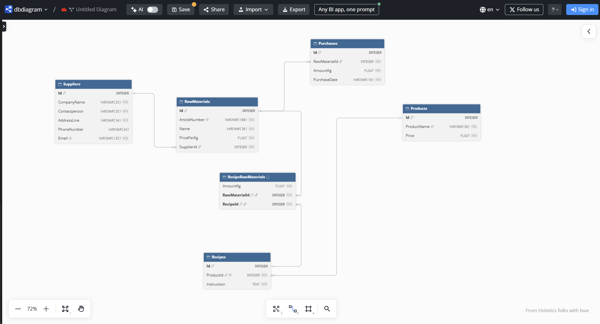

# Mormor Dagnys Bageri

SQLite-databas för leverantörer, råvaror, inköp, produkter och recept.

## Kör i denna ordning
1. `scripts/createtables.sql`
2. `scripts/addtestdata.sql`
3. `scripts/testqueries.sql` (innehåller VG-testet, kör `PRAGMA foreign_keys = ON;` först)

### ERD
Skapad med dbdiagram.io

